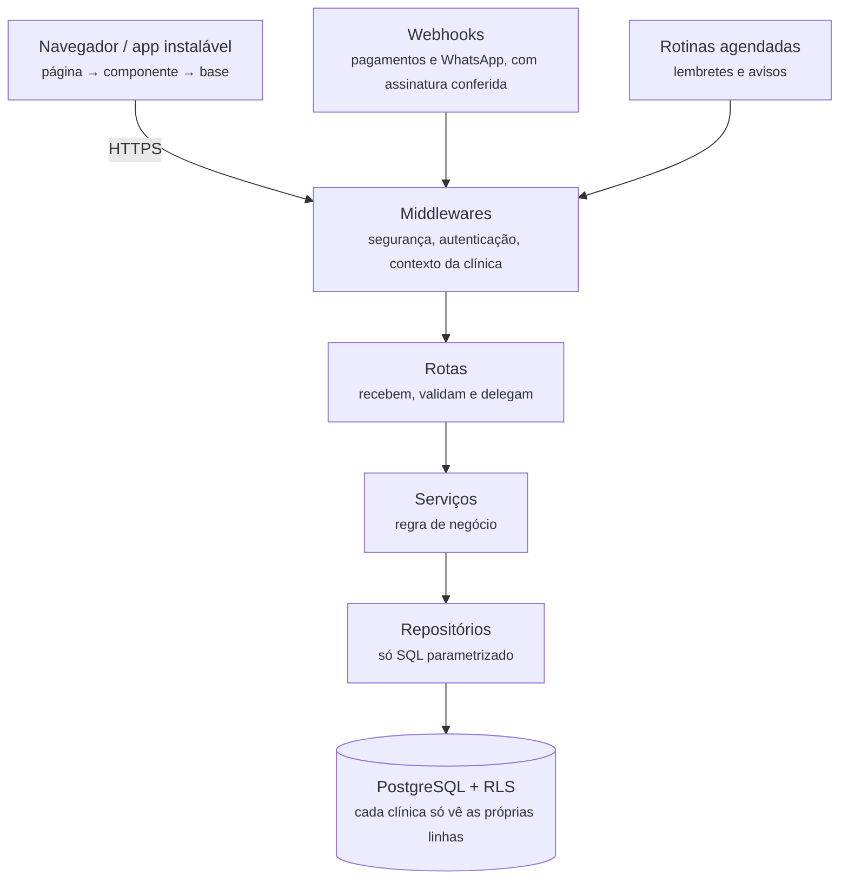
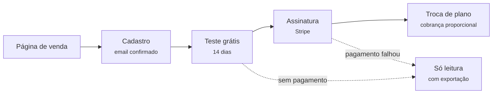

# CRESCER

**Agenda, prontuário e financeiro da clínica num lugar só.**

SaaS de gestão para clínicas de fisioterapia, terapia ocupacional, fonoaudiologia e psicologia, feito para lidar com dados de saúde do jeito que a LGPD pede.

> Este repositório apresenta o projeto. O código-fonte é privado porque o sistema guarda dados clínicos de pacientes.

---

## Sumário

- [O problema](#o-problema)
- [Funções](#funções)
- [Stack](#stack)
- [Arquitetura](#arquitetura)
- [Segurança e LGPD](#segurança-e-lgpd)
- [Modelo SaaS](#modelo-saas)
- [Processo e qualidade](#processo-e-qualidade)

---

## O problema

Terapeutas costumam dividir o dia entre agenda no celular, evolução em papel, financeiro em planilha e confirmação manual no WhatsApp. São ferramentas espalhadas para dados que exigem cuidado redobrado.

| Antes | Com o CRESCER |
|---|---|
| Agenda no celular | Agenda da equipe inteira |
| Evolução em papel | Prontuário com autor e histórico |
| Financeiro em planilha | Receitas, despesas e mensalistas |
| Confirmação manual no WhatsApp | Lembrete automático com link para confirmar |
| Recibo feito à mão | Recibo em PDF num clique |

## Funções

| Módulo | O que faz |
|---|---|
| **Hoje** | O dia do terapeuta numa tela só |
| **Agenda** | Visão de semana, recorrência e integração com o Google Agenda |
| **Prontuário** | Evoluções assinadas, gráfico de progresso e relatórios em PDF |
| **Financeiro** | Receitas, despesas, fechamento mensal e recibos |
| **Confirmação** | Lembrete no WhatsApp 24 horas antes, com link para confirmar presença |
| **Equipe** | Convites, papéis e profissionais que atendem em mais de uma clínica |
| **Relatórios com IA** | Rascunho a partir das evoluções, sempre revisado pelo terapeuta |
| **App instalável** | PWA que funciona no celular e no computador |

## Stack

| Camada | Tecnologias |
|---|---|
| **Frontend** | React 18, TypeScript, Vite (rotas carregadas sob demanda), CSS com design tokens, PWA |
| **Backend** | Node.js, Express, validação com zod, autenticação em duas etapas (TOTP), geração de PDF |
| **Banco de dados** | PostgreSQL com Row Level Security, permissões por coluna e dados de terceiros cifrados |
| **Integrações** | Stripe, WhatsApp Business, Google Agenda, email transacional, captcha |
| **Infra** | Vercel (serverless), GitHub Actions, rotinas agendadas |
| **Qualidade** | Vitest, Supertest, Playwright, testes de mutação, Biome, verificação de arquitetura |
| **Observabilidade** | Sentry, OpenTelemetry, logs estruturados |

## Arquitetura

As camadas não se atravessam. Rota não acessa o banco, serviço não escreve SQL, e repositório não conhece HTTP. Essas regras são verificadas automaticamente no CI, tanto no backend quanto no frontend.

## Segurança e LGPD

O sistema guarda dados de saúde, que a LGPD trata como dados sensíveis. Isso pesa em quase toda decisão do projeto.

- **Multiempresa isolado.** Toda consulta filtra pela clínica, e o Row Level Security do PostgreSQL é uma segunda barreira contra um filtro esquecido.
- **Acesso.** Verificação em duas etapas, permissões por papel aplicadas no servidor e sessões que podem ser encerradas a qualquer momento. Trocar a senha derruba todas as sessões.
- **Prontuário íntegro.** O próprio banco registra quem escreveu cada evolução.
- **Nada vaza.** Nenhum dado de paciente vai para logs, monitoramento ou armazenamento do navegador.
- **Ciclo de vida dos dados.** Exportação a qualquer momento e exclusão completa depois do prazo de guarda, com aviso prévio.
- **Testado.** Toda rota com dados de clínica tem teste de isolamento entre empresas.

## Modelo SaaS

- Planos para profissional solo e para clínicas, com cobrança mensal ou anual.
- Emails automáticos antes do fim do teste e quando o pagamento falha.
- Sem pagamento, a clínica entra em modo só leitura e pode exportar os dados.
- Um painel administrativo acompanha as clínicas e a situação das assinaturas.

## Processo e qualidade

| | |
|---|---|
| **200+** | issues e pull requests |
| **1.000+** | testes automatizados |
| **3 níveis** | unitário, integração com banco real e end-to-end |
| **0** | merges direto na branch principal |

Toda mudança segue o fluxo **issue → branch → pull request**:

- Todo bug corrigido ganha um teste que falhava antes da correção.
- O CI roda lint, busca de código morto, verificação de arquitetura, testes e build em todo PR.
- O deploy só sai da `main`, com tudo verde.
- Commits seguem o Conventional Commits, conferido automaticamente.

---

Quer conversar sobre o projeto? Abra uma issue neste repositório ou me chame no LinkedIn.

